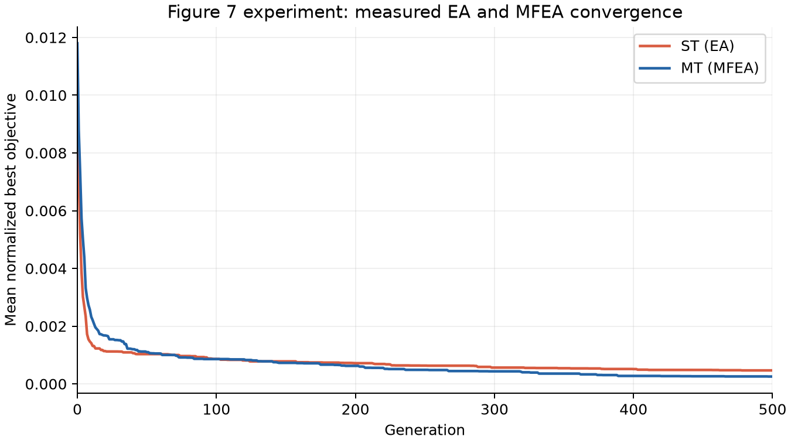
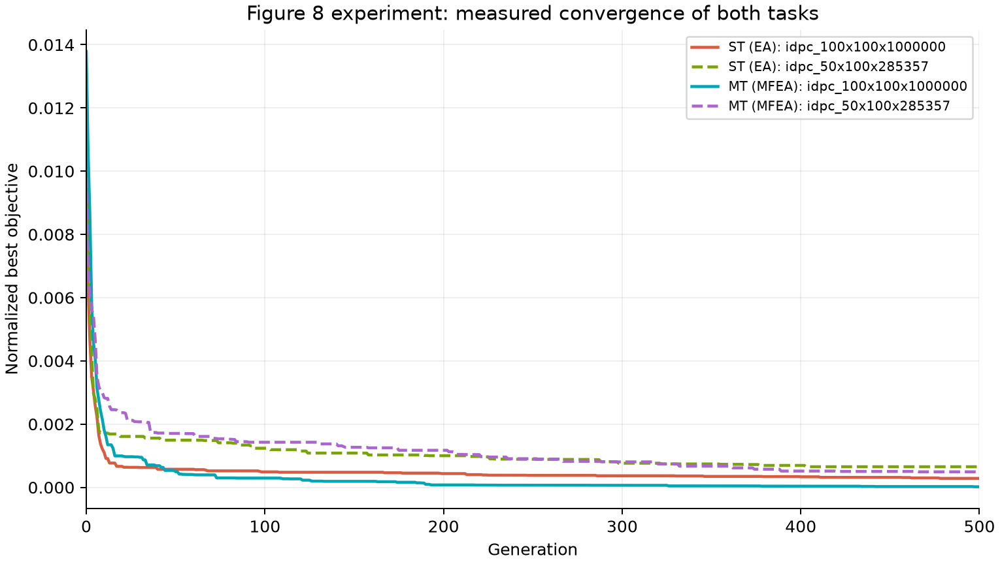

# Full CEC 2020 experiment: measured results

All four component algorithms are used: GPA, random initialization, PMX/TPX crossover, and swap/reset mutation.
EA optimizes each instance independently; MFEA jointly optimizes inferred adjacent-size pairs. No pruning, GNN, oracle answers, local search or repair enters either search.

Setup: 30 independent seeds per scenario; population 100, generations 500, rmp 0.5, mutation rate 0.05.
Published parameter values used: **True**. Benchmark: 42 instances, 84 algorithm/instance rows, 2520 path records.
C-experiment: the published 100x100 + 50x100 pair, both EA controls and joint MFEA, 120 path records.

## Agreement with Tables III and IV

| Method | BF and printed AVG both match | Feasible runs |
|---|---:|---:|
| EA | 8/42 | 1260/1260 |
| MFEA | 7/42 | 1260/1260 |

**Running the complete experiment does not establish reproduction of the published numbers.** Numerical agreement is reported above; remaining gaps are visible in the tables.

## Table II comparison

| Set | NIB | NIE | NIW | Max RPD % | Mean RPD all % | Mean RPD improved % | Paper NIB/NIE | Paper max/mean RPD % |
|---|---:|---:|---:|---:|---:|---:|---|---|
| set1 | 14 | 9 | 1 | 7.025 | 0.867 | 1.581 | 18/6 | 41.7/13.2 |
| set2 | 12 | 0 | 6 | 3.680 | 0.946 | 1.966 | 17/1 | 15.8/4.6 |

RPD = 100*(EA AVG - MFEA AVG)/EA AVG. Mean-all includes every finite pair; mean-improved includes only strict MFEA improvements.
The printed reference rows yield mean-all 9.948% / 4.296% and mean-improved 13.264% / 4.549%, whereas Table II prints 13.2% / 4.6%. The article does not specify the averaging subset or publish unrounded run values, so this discrepancy is reported rather than forced to match.

## C-experiment and figures

Normalize each task as `(f - f_min)/(f_max - f_min)` using the finite minimum and maximum of all evaluated candidates from both methods and all runs; then average tasks and seeds.
This follows the normalization described in [Gupta, Ong and Feng, reference 4, page 10](https://memetic-computing.org/publication/journal/Multifactorial_Evolution_ONLINE_VERSION.pdf). Extrema are measured after the search, never used as optimization guidance.
The zero-range convention maps a constant task to zero. Failed best values stay missing, invalidate the aggregate, and are never silently discarded.
Raw and normalized curves are exported even when they disagree with the paper. Generations 0..500 are used, without smoothing, selecting favorable seeds or copying figure coordinates.

- [Table II](table_II.csv), [Table III](table_III.csv), [Table IV](table_IV.csv).
- [Benchmark report](benchmark/REPORT.md), [all final paths](benchmark/paths.json).
- [C-experiment report](convergence/REPORT.md), [raw curves](convergence/convergence.csv).
- [Per-task normalized curves](convergence/normalized_per_task.csv), [averaged normalized curves](convergence/normalized_average.csv), [normalization extrema](convergence/normalization.json).
- [Independent validation](validation.json), [summary metrics](metrics.json).
- [Figure 7 PNG](figure_7.png), [SVG](figure_7.svg); [Figure 8 PNG](figure_8.png), [SVG](figure_8.svg).

## Reproducibility limits

Algorithm 1 is interpreted literally: arriving-node sigma, literal modulo, and original file edge order. Sigma at a node without outgoing edges is stored as numeric 1, resolving the article's undefined '-' modulo case.
Adjacent task pairing is inferred from repeated reported times, not author-confirmed. The convergence pair is stated explicitly in the paper. Seeds are 100..129 by default; author seeds are unavailable.
The framework follows reference [4]'s assortative mating, skill inheritance, selective evaluation and elitist scalar-fitness selection, with the CEC paper's custom representation/operators. Parent sampling, extra mutation scheduling and population allocation remain documented implementation choices.
Unevaluated tasks are excluded from rank calculation, equivalent to assigning infinite cost when feasible evaluated solutions exist; this differs from random ranking of unevaluated infinite costs in infeasible-only populations.
Population 100 is shared by a multitask group. Each EA control has 100 individuals of its own. Evaluation counts are exported per task; no claim of equal aggregate evaluation budgets is made.
Rs values are measured Python solver time; MFEA time is shared across tasks in a group. They are not directly comparable with the paper's Java/i7 runtime. Loading graphs and report generation are outside solver timings.
Only the complete benchmark and published convergence scenario are retained; there is no parameter grid or extra method outside the paper.
