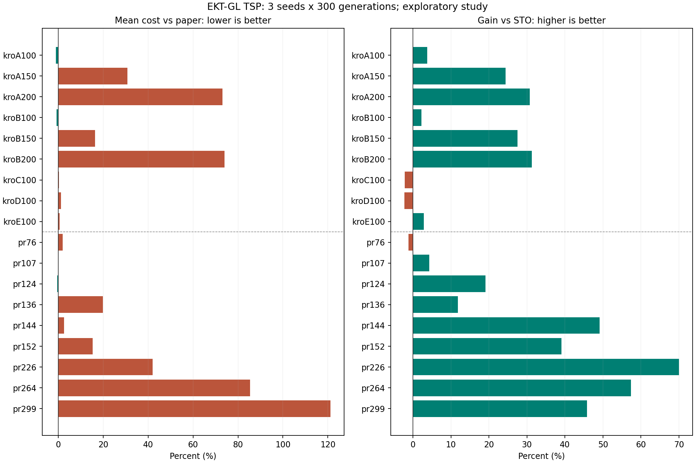

# EKT-GL cho TSP: kết quả thực nghiệm

**[Mở báo cáo thực nghiệm đầy đủ](results/tsp/REPORT.md)** — bảng chi tiết từng task, mean/std, gap, kiểm định thống kê và đồ thị hội tụ.

## Kết quả chính

Mọi objective đều cần tối thiểu hóa. Các tỷ lệ dưới đây là trung bình không trọng số trên 9 task, không phải tỷ lệ của tổng objective.

| Benchmark | Δmean so EKT-GL paper | Mean gain so STO | Best-of-N gap so LKH paper | Task mean tốt hơn STO | Thắng sau Holm |
|---|---:|---:|---:|---:|---:|
| TSP-kro | +21.64% | +13.16% | 22.03% | 7/9 | 0/9 |
| TSP-pr | +31.95% | +32.82% | 27.36% | 8/9 | 0/9 |



Bảng chi tiết 18 task (mean/std, best, p-value, gap và thời gian) tại [báo cáo đầy đủ](results/tsp/REPORT.md); số liệu máy đọc được tại [CSV](results/tsp/summary.csv) và [JSON](results/tsp/summary.json). Đường hội tụ: [TSP-kro](results/tsp/kro_convergence.png), [TSP-pr](results/tsp/pr_convergence.png).

## EKT-GL + 2-opt hội tụ sau chạy

Lấy đúng tour EKT-GL cuối cùng của từng seed rồi chạy thêm first-improvement 2-opt đến hội tụ (tối đa 10.000 cải thiện). Đây là biến thể hậu xử lý có thêm ngân sách local search, không sửa bảng chính và không phải xác nhận tái lập cùng thiết lập paper. Không dùng kết quả này để so thắng/thua với STO chưa hậu xử lý.

| Benchmark | Δmean bản chính so paper | Δmean sau 2-opt so paper | Giảm mean nhờ hậu xử lý | Gap best sau 2-opt so LKH |
|---|---:|---:|---:|---:|
| TSP-kro | +21.64% | -0.97% | 14.22% | 4.97% |
| TSP-pr | +31.95% | -1.16% | 18.61% | 3.74% |

Bảng mean/std đủ 18 task: [post_2opt/summary.csv](results/tsp/post_2opt/summary.csv). Các tour đã tinh chỉnh và thời gian bổ sung nằm trong các JSON cùng thư mục. Tất cả nghiệm hậu xử lý cũng được kiểm chứng độc lập trong audit.json. Kết quả định lượng được phần cải thiện trên các tour đã có; chưa cho biết hiệu quả nếu thay đổi cường độ 2-opt ngay trong vòng tiến hóa.

## Khác biệt đã xác định

**Sửa OX cho TSP.** Bản OX dùng trong CVRP cũ quét cha mẹ thứ hai từ đầu nhưng điền con từ sau điểm cắt. Vì hai vị trí không trùng nhau, ngay cả lai hai tour giống nhau cũng có thể phá cấu trúc tour. TSP nay quét và điền theo cùng thứ tự vòng, bảo đảm hai cha mẹ giống nhau sinh chính tour đó. Đã thêm test quy luật này và ví dụ kiểm tra thứ tự OX. Luồng CVRP giữ cách quét cũ; các lượt TSP trước khi sửa được tách khỏi kết quả cuối.

Đối chiếu hai phiên bản trên TSP-kro, cùng 3 seed và cấu hình: sửa thứ tự quét OX làm mean EKT-GL giảm trung bình **30.12%**; Δmean so paper từ **+72.23%** xuống **+21.64%**. Đây là so sánh cài đặt trước/sau sửa, không phải baseline của paper. Các file trước sửa chỉ giữ trong thư mục chẩn đoán, không được trộn vào bảng chính.

**Chuẩn hóa tọa độ.** Đã sửa riêng TSP sang `(xy − xy.min()) / (xy.max() − xy.min())`, dùng một cặp min/max chung cho toàn ma trận, bảo toàn tỷ lệ hình học. Cách chuẩn hóa riêng từng trục của bản CVRP làm biến dạng TSP. Kiểm tra độc lập: optimum TSPLIB nguyên chia khoảng tọa độ chung khớp 18/18 giá trị LKH của Table IX sau làm tròn 2 chữ số. Đây là suy luận về thang đo của paper, vì tác giả không ghi công thức chuẩn hóa cụ thể. CVRP giữ nguyên hành vi cũ; các lượt TSP thang đo cũ được tách khỏi kết quả chính.

**Cường độ local search.** Bản CVRP nhận tối đa một bước first-improvement 2-opt mỗi lần gọi; benchmark chính giữ cấu hình này. Kiểm tra riêng dưới đây dùng cùng tour nearest-neighbor, chỉ thay số bước 2-opt; không dùng nhãn tối ưu để tạo nghiệm. Đây là kiểm tra trên tour nearest-neighbor; hậu xử lý trực tiếp nghiệm EKT-GL được báo ở mục riêng phía trên.

| Task kiểm tra | Nearest-neighbor | Sau 1 bước 2-opt | 2-opt đến hội tụ |
|---|---:|---:|---:|
| kroA100 | 6.823 | 6.804 | 5.803 |
| kroA200 | 9.065 | 9.063 | 7.531 |
| pr76 | 7.830 | 7.814 | 5.565 |
| pr299 | 8.564 | 8.542 | 7.084 |

Kết quả chẩn đoán đủ 18 task và các route: [local_search_diagnostic.json](results/tsp/local_search_diagnostic.json). Tất cả đạt điều kiện không có bước first-improvement kế tiếp. Không coi heuristic này là baseline EMTO của paper.

**Huấn luyện online.** `OnlineTrainer` gộp loss tất cả task rồi cập nhật Adam một lần cho mỗi epoch/transfer. Với 300 thế hệ, λ=10, epoch=1, mạng nhận 30 optimizer step. Paper ghi epoch=1 nhưng không đủ chi tiết để xác nhận batching/optimizer step trùng khớp. Đây là điểm cần ablation tiếp, không phải nguyên nhân đã chứng minh của độ lệch.

## Giới hạn diễn giải

- Chỉ 3 seed so với 20 trong paper. Best-of-3 khác ngân sách best-of-20; mean/std chưa ổn định. Rank-sum dùng xấp xỉ chuẩn, nên p-value với mẫu nhỏ chỉ mang tính thăm dò. Holm áp dụng riêng 9 task/bộ; chưa kết luận transfer tốt hơn một cách chắc chắn khi không qua ngưỡng đã hiệu chỉnh.
- LKH và các số EKT-GL/MTEA-AST của paper được chép từ Table II/IX; không chạy lại LKH hoặc 5 baseline EMTO của tác giả. Khoảng cách với paper là mô tả, không phải kiểm định thống kê giữa hai triển khai.
- STO dùng cùng toán tử nhưng có 300 thế hệ EA, EKT-GL có 270 thế hệ EA và 30 transfer. Chưa cân bằng số đánh giá hàm mục tiêu hoặc thời gian.
- CPU không có CUDA. Một tiến trình tính trước STO chạy trong lúc EKT-GL thực thi, vì vậy thời gian có tranh chấp tài nguyên; không dùng để suy ra speedup so với máy RTX 3090 của paper.
- Chưa chạy TSP-kro-syn, TSP-pr-syn hoặc TSP-all. Chưa có ablation về local search trong từng thế hệ và batching để giải thích hết độ lệch.

## Chạy lại

```powershell
python -m pip install -r requirements-tsp.txt
python run_tsp.py --runs 3 --generations 300
python -m experiments.check_tsp_local_search
python -m experiments.refine_tsp_results --runs 3
python -m experiments.audit_tsp_results --runs 3
python -m experiments.summarize_tsp
python -m unittest discover -s tests -q
```

Chạy tiếp đủ ngân sách 20 seed của paper:

```powershell
python run_tsp.py --runs 20 --generations 300
python -m experiments.refine_tsp_results --runs 20
python -m experiments.audit_tsp_results --runs 20
python -m experiments.summarize_tsp
```

Cache lưu route, objective, history, loss, attention, seed, config, phiên bản thư viện, hash dữ liệu và source hash. Runner kiểm tra route, tính lại chi phí và kiểm tra hội tụ trước khi dùng lại. Tăng số seed tiếp tục các seed còn thiếu nếu mã/config/dữ liệu giữ nguyên.

Kiểm chứng độc lập: **12 file seed, 108 tour bảng chính và 54 tour hậu xử lý**; tính lại độ dài trực tiếp từ tọa độ TSPLIB float64, không dùng distance matrix hay evaluate() của solver. Sai số lớn nhất: 3.03e-06 cho bảng chính và 9.48e-07 cho hậu xử lý. Kết quả: [audit.json](results/tsp/audit.json).
