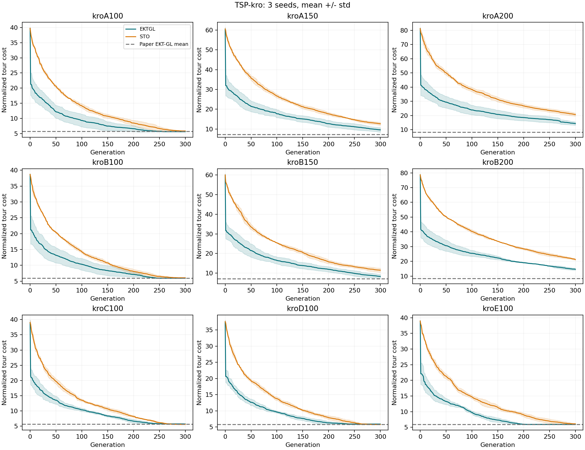
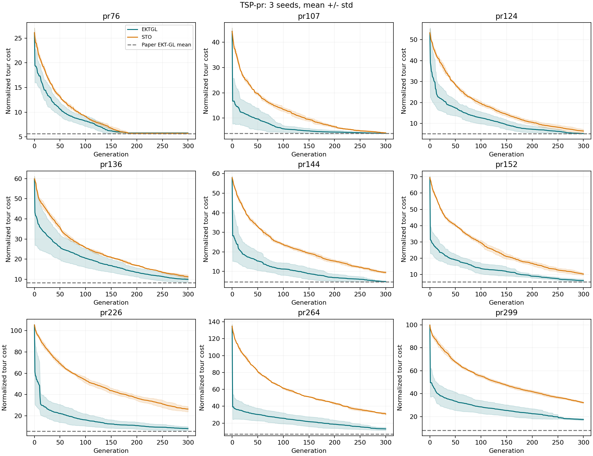

# Áp dụng EKT-GL cho TSP và đối chiếu paper

Nguồn tham chiếu: Lv, Liu, Li, *Evolutionary Knowledge Transfer via Graph Learning for Many-task Heterogeneous Routing Problems*, DOI 10.1109/TEVC.2025.3649317. Table I/II/IX, trang 6/7/14 của PDF người dùng cung cấp.

Chạy thực tế **3 seed (0–2), 300 thế hệ**, trên 18 task; các task cùng benchmark được giải đồng thời qua một mạng EKT-GL. Paper chạy 20 seed, 300 thế hệ.

## Thiết lập và cách tính

- Population=30; transfer interval=10; elite=5; epochs=1; embedding=128; GCN layers=4; Adam lr=0.001; swap mutation=0.2; 2-opt passes=1.
- Dùng lõi `ekt_gl`, swap và first-improvement 2-opt từ thí nghiệm CVRP; sửa quét OX riêng cho TSP theo thứ tự vòng bắt đầu sau điểm cắt thứ hai. OX cũ quét từ đầu cha mẹ thứ hai nhưng điền từ điểm cắt, khiến lai hai cha mẹ giống nhau vẫn phá tour. Luồng CVRP giữ cách quét cũ để không thay đổi thí nghiệm đã có. Mỗi lần gọi 2-opt vẫn chỉ nhận tối đa một cải thiện với cấu hình mặc định.
- Tối ưu tốc độ 2-opt riêng TSP: dùng delta bốn cạnh để loại các phép đảo chắc chắn không cải thiện, kèm chặn sai số tổng float32; mọi ứng viên còn lại vẫn tính objective gốc, giữ thứ tự first-improvement. Test đối chiếu với vòng lặp gốc trên tour ngẫu nhiên, tọa độ trùng, và tour vòng tròn (3–299 nút). Không thay đổi nhánh CVRP.
- TSP chuẩn hóa bằng một min và max chung trên toàn bộ ma trận tọa độ của từng task: (xy − xy.min()) / (xy.max() − xy.min()). Phép biến đổi bảo toàn hình học. Đây là suy luận từ đối chiếu thang đo: optimum TSPLIB chia khoảng tọa độ chung khớp 18/18 giá trị LKH Table IX sau làm tròn 2 chữ số. Paper chỉ nói chuẩn hóa tọa độ, không ghi công thức cụ thể. CVRP trong repo vẫn dùng chuẩn hóa riêng từng trục.
- Chi phí dùng Euclid liên tục trên tọa độ chuẩn hóa, gồm cạnh quay về điểm đầu. Optimum TSPLIB nguyên chỉ dùng để kiểm tra thang đo, không dùng để tính gap: gap luôn dùng cột LKH Table IX.
- STO cùng khởi tạo và toán tử, không transfer. STO có 300 lượt EA; EKT-GL có 270 lượt EA + 30 lượt transfer với cấu hình paper. Đây là cùng ngân sách thế hệ, chưa phải cùng số lần đánh giá hàm mục tiêu hoặc cùng thời gian.
- Seed cả NumPy và Torch; CPU, 1 Torch thread mỗi solver. Runner mặc định chạy tuần tự; trong đợt thực nghiệm này một tiến trình phụ tính trước STO trong khi EKT-GL đang chạy. Thời gian có tranh chấp tài nguyên, chỉ để tham khảo. Tính từ khởi tạo solver đến kết quả, gồm train/inference, không gồm import, tải dữ liệu hay viết báo cáo.
- Std dùng ddof=0 để nhất quán báo cáo CVRP. Paper không mô tả rõ quy ước ddof.
- Δpaper = 100 × (mean bản này / mean Table II − 1); âm là chi phí thấp hơn paper. Improve STO = 100 × (1 − mean EKT-GL / mean STO).
- Gap best/mean = 100 × (best/mean EKT-GL / LKH Table IX − 1). LKH là số tham chiếu lấy từ paper, không phải một lần chạy LKH tại máy này. Table IX làm tròn obj đến 2 chữ số nên không tính lại cột gap paper từ các obj đã làm tròn.
- Wilcoxon rank-sum hai phía (scipy.stats.ranksums), ngưỡng 0,05 như paper; bổ sung Holm cho 9 task trong từng benchmark. Seed ghép giữa hai phương pháp nhưng dùng rank-sum để bám paper. Không kiểm định với số liệu paper vì không có kết quả từng seed của tác giả.

**Đây là thí nghiệm thăm dò, chưa tái lập đủ thiết lập paper.** Số seed ít làm mean/std và p-value chưa ổn định. Đặc biệt best-of-N của bản này không cùng ngân sách với best-of-20 trong Table IX.

## TSP-kro

| Task | EKT-GL mean ± std | Paper mean ± std | Δpaper % | STO mean ± std | Improve STO % | p rank-sum | p Holm |
|---|---:|---:|---:|---:|---:|---:|---:|
| kroA100 | 5.642 ± 0.169 | 5.70 ± 0.13 | -1.01 | 5.863 ± 0.042 | +3.77 | 0.1266 | 0.6332 |
| kroA150 | 9.574 ± 1.154 | 7.32 ± 0.14 | +30.80 | 12.666 ± 0.754 | +24.41 | 0.04953 | 0.4458 |
| kroA200 | 14.320 ± 1.212 | 8.27 ± 0.18 | +73.15 | 20.687 ± 1.084 | +30.78 | 0.04953 | 0.4458 |
| kroB100 | 5.924 ± 0.081 | 5.97 ± 0.13 | -0.77 | 6.060 ± 0.067 | +2.24 | 0.1266 | 0.6332 |
| kroB150 | 8.365 ± 1.026 | 7.19 ± 0.13 | +16.34 | 11.536 ± 1.037 | +27.49 | 0.04953 | 0.4458 |
| kroB200 | 14.570 ± 0.693 | 8.37 ± 0.21 | +74.08 | 21.206 ± 0.488 | +31.29 | 0.04953 | 0.4458 |
| kroC100 | 5.675 ± 0.046 | 5.66 ± 0.15 | +0.27 | 5.557 ± 0.153 | -2.13 | 0.5127 | 0.8257 |
| kroD100 | 5.874 ± 0.183 | 5.80 ± 0.10 | +1.28 | 5.747 ± 0.078 | -2.22 | 0.2752 | 0.8257 |
| kroE100 | 5.926 ± 0.117 | 5.89 ± 0.10 | +0.61 | 6.098 ± 0.198 | +2.83 | 0.2752 | 0.8257 |

| Task | Best bản này | LKH paper | Gap best % | Gap mean % | Best paper (20 seed) | Gap paper % |
|---|---:|---:|---:|---:|---:|---:|
| kroA100 | 5.446 | 5.41 | 0.66 | 4.29 | 5.52 | 2.09 |
| kroA150 | 7.942 | 6.69 | 18.72 | 43.12 | 7.06 | 5.48 |
| kroA200 | 12.622 | 7.44 | 69.65 | 92.47 | 8.00 | 7.57 |
| kroB100 | 5.863 | 5.63 | 4.14 | 5.23 | 5.71 | 1.48 |
| kroB150 | 6.974 | 6.64 | 5.03 | 25.98 | 6.99 | 5.34 |
| kroB200 | 13.715 | 7.47 | 83.61 | 95.05 | 8.00 | 7.16 |
| kroC100 | 5.620 | 5.28 | 6.44 | 7.48 | 5.38 | 1.98 |
| kroD100 | 5.723 | 5.43 | 5.39 | 8.18 | 5.53 | 1.83 |
| kroE100 | 5.818 | 5.56 | 4.64 | 6.58 | 5.74 | 3.29 |

Trung bình Δpaper: **+21.64%**; gap best so LKH: **22.03%** (paper: 4.02%). EKT-GL có mean tốt hơn STO ở **7/9** task, tốt hơn có ý nghĩa ở **4/9** theo p thô và **0/9** sau Holm.

- EKTGL: 294.6 ± 8.7 giây/seed cho cả 9 task; tổng 883.9 giây.
- STO: 104.8 ± 13.1 giây/seed cho cả 9 task; tổng 314.5 giây.
- Paper Table IX báo 88.25 giây cho EKT-GL trên benchmark; khác máy (paper dùng i7-8700K + RTX 3090, 64 GB RAM) và chi tiết triển khai nên không suy ra speedup từ tỷ lệ thời gian.



## TSP-pr

| Task | EKT-GL mean ± std | Paper mean ± std | Δpaper % | STO mean ± std | Improve STO % | p rank-sum | p Holm |
|---|---:|---:|---:|---:|---:|---:|---:|
| pr76 | 5.790 ± 0.110 | 5.68 ± 0.07 | +1.94 | 5.725 ± 0.118 | -1.15 | 0.5127 | 1 |
| pr107 | 3.938 ± 0.019 | 3.94 ± 0.09 | -0.06 | 4.116 ± 0.161 | +4.33 | 0.5127 | 1 |
| pr124 | 5.204 ± 0.050 | 5.23 ± 0.09 | -0.49 | 6.434 ± 0.838 | +19.11 | 0.04953 | 0.4458 |
| pr136 | 9.946 ± 1.382 | 8.30 ± 0.13 | +19.84 | 11.275 ± 0.891 | +11.78 | 0.2752 | 0.8257 |
| pr144 | 4.839 ± 0.288 | 4.72 ± 0.11 | +2.52 | 9.505 ± 0.502 | +49.09 | 0.04953 | 0.4458 |
| pr152 | 6.285 ± 0.943 | 5.45 ± 0.08 | +15.33 | 10.320 ± 0.676 | +39.10 | 0.04953 | 0.4458 |
| pr226 | 7.883 ± 1.723 | 5.55 ± 0.16 | +42.04 | 26.264 ± 2.537 | +69.99 | 0.04953 | 0.4458 |
| pr264 | 13.142 ± 1.830 | 7.09 ± 0.24 | +85.36 | 30.810 ± 1.329 | +57.34 | 0.04953 | 0.4458 |
| pr299 | 17.421 ± 0.725 | 7.88 ± 0.37 | +121.08 | 32.124 ± 0.594 | +45.77 | 0.04953 | 0.4458 |

| Task | Best bản này | LKH paper | Gap best % | Gap mean % | Best paper (20 seed) | Gap paper % |
|---|---:|---:|---:|---:|---:|---:|
| pr76 | 5.657 | 5.52 | 2.49 | 4.90 | 5.55 | 0.57 |
| pr107 | 3.923 | 3.78 | 3.79 | 4.17 | 3.82 | 1.10 |
| pr124 | 5.150 | 5.01 | 2.80 | 3.88 | 5.08 | 1.42 |
| pr136 | 8.292 | 7.77 | 6.72 | 28.01 | 8.07 | 3.91 |
| pr144 | 4.602 | 4.54 | 1.36 | 6.58 | 4.54 | 0.05 |
| pr152 | 5.466 | 5.23 | 4.51 | 20.18 | 5.29 | 1.07 |
| pr226 | 5.450 | 5.28 | 3.22 | 49.30 | 5.37 | 1.73 |
| pr264 | 10.652 | 6.20 | 71.80 | 111.97 | 6.59 | 6.29 |
| pr299 | 16.569 | 6.64 | 149.53 | 162.37 | 7.38 | 11.18 |

Trung bình Δpaper: **+31.95%**; gap best so LKH: **27.36%** (paper: 3.04%). EKT-GL có mean tốt hơn STO ở **8/9** task, tốt hơn có ý nghĩa ở **6/9** theo p thô và **0/9** sau Holm.

- EKTGL: 334.8 ± 19.5 giây/seed cho cả 9 task; tổng 1004.3 giây.
- STO: 166.0 ± 9.2 giây/seed cho cả 9 task; tổng 498.0 giây.
- Paper Table IX báo 118.36 giây cho EKT-GL trên benchmark; khác máy (paper dùng i7-8700K + RTX 3090, 64 GB RAM) và chi tiết triển khai nên không suy ra speedup từ tỷ lệ thời gian.



## Nhận định và giới hạn

- Chi phí càng thấp càng tốt. Kết quả đo được trong bảng quyết định mức khớp với paper; không coi chạy ra nghiệm hợp lệ là đã tái lập chất lượng thuật toán.
- Đây là bản triển khai trong repo, không phải source chính thức đã xác minh của tác giả. Paper chưa nêu đủ chi tiết để khẳng định khớp: elite ε, cường độ 2-opt và một số toán tử tiến hóa. Chuẩn hóa TSP được chọn theo kiểm tra thang đo độc lập với bộ giải, không dò theo objective đầu ra của EKT-GL. Không điều chỉnh các tham số tiến hóa/huấn luyện sau khi xem kết quả.
- Nếu gap lớn, cần kiểm tra cường độ local search, hội tụ quần thể và chất lượng heatmap trước khi kết luận phương pháp EKT-GL không hiệu quả. Chưa làm ablation nên các nguyên nhân này chỉ là giả thuyết.
- Chưa chạy TSP-kro-syn, TSP-pr-syn, TSP-all hoặc tái cài đặt 5 baseline EMTO. Cột MTEA-AST công bố được lưu trong CSV để tham khảo; không phải kết quả chạy lại.
- Best route được kiểm tra hoán vị, tính lại objective; history phải không tăng và khớp final cost. Mỗi seed lưu history, loss và attention của mọi lần transfer.

Nguồn bảng optimum TSPLIB dùng cho kiểm tra thang đo: [tài liệu TSPLIB95 gốc, bản lưu trong TSPLib.Net](https://github.com/pdrozdowski/TSPLib.Net/blob/master/TSPLIB95/DOC.PS). Chia optimum nguyên chỉ là kiểm tra xấp xỉ vì Euclid liên tục khác EUC_2D làm tròn.

## Tái lập và chạy tiếp

```powershell
python -m pip install numpy scipy torch matplotlib
python run_tsp.py --runs 3 --generations 300
python run_tsp.py --runs 20 --generations 300
```

Dữ liệu trong `tsp_data/`; nguồn và SHA-256 từng file trong `raw/*.json`. Mặc định không tải qua mạng; thêm `--download` nếu thiếu dữ liệu. Cache tách theo config, source hash, phiên bản thư viện và hash dữ liệu; chỉ tái dùng seed đã qua kiểm tra. Tăng --runs sẽ tiếp tục các seed còn thiếu.

`summary.csv`/`summary.json`: toàn bộ chỉ số; `raw/*.json`: kết quả từng seed. Biểu đồ hiển thị mean và dải ±1 std của best-so-far từng task, không phải khoảng tin cậy.
